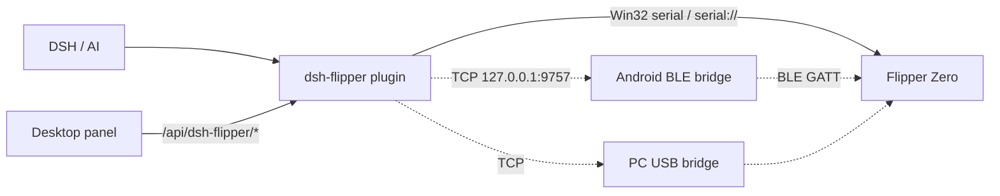

# dsh-flipper

Control a **Flipper Zero** from [DeepSeek Harness](https://github.com/deepseek-ai) with natural
language: see its screen, press buttons, launch apps, read/write the SD card, and drive
Sub-GHz / NFC / RFID / Infrared / BadUSB / GPIO.

> Unofficial project. Not affiliated with Flipper Devices Inc. Use it only on your own devices.

## What's inside

| Part | Description |
|---|---|
| **DSH plugin** (repo root, Node.js) | Registers `flipper_*` tools, injects an operating guide into the system prompt, ships a `dsh-flipper` skill, adds a **Flipper panel to the desktop Web GUI** (screen mirror, D-pad, apps, SD card, CLI, one-click connect), and a status panel to the dsh-go mobile app |
| **Android BLE bridge** (`android/`) | Bridges the Flipper's Bluetooth serial profile to `127.0.0.1:9757`, because the DSH engine runs inside proot and cannot access Android BLE APIs |

On a desktop the easiest path needs no scripts at all: the plugin drives the COM port through
Win32 directly (`CreateFileW` / `SetCommState` / `ReadFile` / `WriteFile` via koffi, which ships
with DSH Desktop), auto-detects the Flipper by USB VID/PID `0483:5740`, and the panel's Connect
button is all a user has to press. The Python bridge (`tools/flipper-bridge.py`) is still there as
a fallback for `tcp://<pc>:9757`.

## Features

- **Screen**: 128x64 monochrome; ASCII (the actual UI), braille, and PNG for `read_image`
- **Input**: up/down/left/right/ok/back, short/long; `observe=true` captures the screen after a keypress
- **Apps**: start/exit/load file/buttons; built-in Sub-GHz, NFC, 125 kHz RFID, Infrared, iButton, Bad USB, U2F, GPIO
- **Files**: list/read/write/delete/rename/md5/stat under `/ext`
- **System**: battery, time, alert, reboot, properties, desktop lock
- **Discovery**: `flipper_capabilities` returns installed FAPs, resource-file counts/examples, tools, and workflows
- **Agent loop**: system prompt + bundled skill + observe → act → observe
- **Desktop panel**: live screen mirror, D-pad, one-click app launch, SD-card browser with text preview, CLI, port picker — sharing one RPC session with the agent
- **No-Python connect on Windows**: native Win32 serial, Flipper auto-detection, optional connect-on-boot
- **dsh-go panel**: live screen, battery, D-pad

## Architecture



## Quick start

```sh
git clone <repo-url> dsh-flipper
cd dsh-flipper
./install.sh          # Linux / macOS / phone proot
# Windows: .\install.ps1
```

Or install straight from GitHub: `dsh plugin --profile desktop add github:<you>/dsh-flipper`.

Restart DSH, then connect:

- **Desktop serial (recommended)**: plug the Flipper in, close qFlipper, open the **Flipper** panel
  in the sidebar and press Connect — or `flipper_connect()` with no arguments
  (`serial://COM6` to be explicit). Nothing else to run on Windows.
- **Android BLE bridge**: install `dist/flipper-ble-bridge-1.6.apk`, turn on Flipper Bluetooth,
  pair (PIN on the Flipper), wait for `TCP 监听 127.0.0.1:9757`, then
  `flipper_connect(endpoint="tcp://127.0.0.1:9757")`.
- **PC USB bridge** (fallback): plug the Flipper into a PC, run `python3 tools/flipper-bridge.py`,
  then `flipper_connect(endpoint="tcp://<pc-ip>:9757")`.
- **PC-side DSH**: install the same plugin on the PC; it gets the same system prompt and
  `dsh-flipper` skill. `flipper_cli` works on `usb`/`serial`, not on `ble`. `link` defaults to
  `ble` on the phone, `serial` for a local port, and `usb` for a TCP bridge.

## Tools

`flipper_connect`, `flipper_disconnect`, `flipper_status`, `flipper_capabilities`,
`flipper_screen`, `flipper_input`, `flipper_app`, `flipper_storage`, `flipper_system`,
`flipper_gpio`, `flipper_cli` (USB CLI only; not available over BLE).

## Protocol

BLE service/characteristics, varint framing, and the 128x64 page-major framebuffer are
documented in [docs/PROTOCOL.md](docs/PROTOCOL.md).

## Build / test

```sh
node test/e2e.mjs          # offline mock: protocol, screen, keys, storage, CLI
node test/api-e2e.mjs      # offline mock: /api/dsh-flipper/* panel routes
cd android && ./build.sh   # or open android/ in Android Studio
```

## License

MIT. The launcher icon is supplied by the project author and is not covered by the MIT
license — see [NOTICE.md](NOTICE.md).

中文说明见 [README.md](README.md)。
