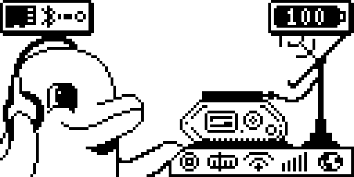
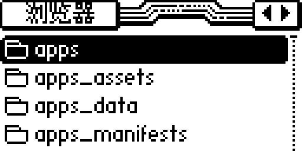
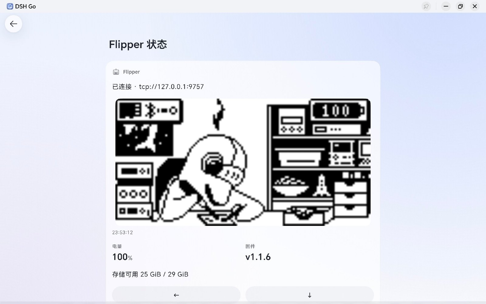
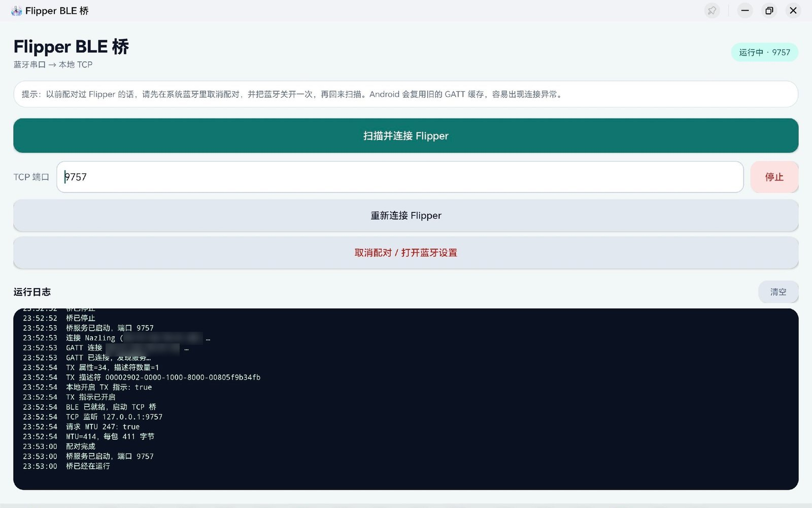
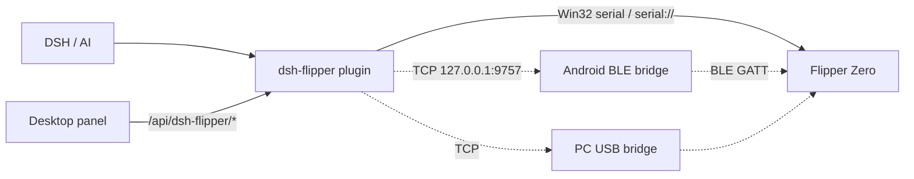

<div align="center">
  
  <h1>dsh-flipper</h1>
  <p><b>Drive a Flipper Zero from AI through DSH</b></p>
  <p><b>Optimized and adapted for the dsh-go Android app</b></p>
  <p>Screen · Buttons · Apps · SD card · Sub-GHz / NFC / RFID / Infrared / BadUSB / GPIO</p>
  <p>Desktop sidebar panel + native Win32 serial: <b>plug in USB and go, no Python</b></p>
  <p>
    
    
    
    
  </p>
</div>

<p><a href="README.md">中文</a> · English</p>

> Unofficial project. Not affiliated with Flipper Devices Inc. Use it only on your own devices.

---

### Status: connected, but the AI has not learned the device yet

**Collecting: DeepSeek (DS) reasoning traces of driving the Flipper Zero.**

I do not have enough of the model's reasoning traces or training data, so the AI is not yet fluent with the Flipper Zero. I'm collecting how you and your agent actually work through it: what you asked, how it inferred the current screen, how it navigated the menus, where it pressed the wrong thing, how it recovered. Real traces are worth more than any amount of prompt text.

So it's worth being explicit about what this project does and does not do:

- **Done**: connects DSH to the Flipper (three links — local serial / BLE bridge / TCP bridge — plus the desktop sidebar panel), and hands the model the *basics* of using the device (the `flipper_*` tool set, an operating section in the system prompt, and the bundled `dsh-flipper` skill).
- **Not done**: the model has not mastered the device. The screen is 128×64 monochrome pixels, menus are icon rows and inverted blocks, and one button means different things on different pages. A tool manual alone does not teach that — it takes repeated trial and error on real tasks.

Share traces or just talk shop: **QQ 1132359085**

---

## What's inside

**dsh-flipper** turns the Flipper Zero into a handheld device an AI can operate. The repo has two halves:

| Part | Description |
|---|---|
| **DSH plugin** (repo root, Node.js) | Registers `flipper_*` tools: screen capture, buttons, launching apps, SD-card read/write, GPIO, system operations; injects an operating guide into the system prompt; bundles the `dsh-flipper` skill; adds a **Flipper panel to the desktop Web GUI** (screen mirror / D-pad / apps / SD card / CLI / one-click connect) and a **"Flipper 状态" panel to the dsh-go mobile app** |
| **Android BLE bridge** (`android/`) | Bridges the Flipper's Bluetooth serial profile to `127.0.0.1:9757` on the phone. The DSH engine runs inside proot and cannot reach Android BLE APIs, so this native bridge is required |

On a desktop with the Flipper plugged into USB, the simplest path is no scripts at all: the plugin drives the serial port through **koffi → Win32 serial APIs** (`CreateFileW` / `SetCommState` / `ReadFile` / `WriteFile`), with no Python and no native module to compile. The panel's Connect button auto-detects the Flipper's COM port by VID `0483` / PID `5740`. The `tools/flipper-bridge.py` TCP bridge is only needed when you cannot get a local serial port.

## Features

- **Screen**: 128x64 monochrome; ASCII (the actual UI), braille, and PNG for `read_image`
- **Input**: up / down / left / right / ok / back, short and long press; `observe=true` captures the screen after a keypress
- **Apps**: start, exit, load file, buttons, read error; built-in Sub-GHz, NFC, 125 kHz RFID, Infrared, iButton, Bad USB, U2F, GPIO, Music Player
- **Files**: list / read / write / delete / rename / md5 / stat under `/ext`
- **System**: battery, time, alert, reboot, properties, desktop lock/unlock
- **Discovery**: `flipper_capabilities` returns built-in apps, third-party FAPs, per-directory resource counts and examples, tool list, and workflows in one call
- **Agent loop**: system prompt + bundled skill + observe → act → observe
- **Desktop panel** (DSH Web GUI sidebar): live screen mirror, D-pad, one-click app launch, SD-card browser with text preview, CLI passthrough, port picker with connect/disconnect — sharing one RPC session with the agent
- **No-Python connect**: native Win32 serial on Windows, optional connect-on-boot, Flipper-aware port enumeration
- **dsh-go adaptation**: status strip above the composer, a "Flipper 状态" side panel (live screen, battery/firmware, D-pad), screen captures rendered as native image cards, and `link` defaulting to `ble` on the phone

## Screenshots

<p align="center">
  
  
</p>
<p align="center"><i>Real Flipper screens captured by the plugin (128x64, scaled 4x)</i></p>

## dsh-go plugin adaptation

The dsh-go mobile app is a Flutter native UI, not the web panel, so the plugin registers native components through `ctx.dshGo` instead of React routes and `/api/dsh-flipper/*`. Data comes from the same `Manager`, so the app and the agent share one RPC session.

| Where | What |
|---|---|
| "Flipper 状态" side panel | 128×64 screen mirror (5 s per frame, PNG inlined into the panel, nothing written to disk), battery/firmware metrics, free storage, six D-pad keys that re-capture after each press, refresh/connect |
| Status strip above the composer | `Flipper 100%` / `Flipper 未连接`, refreshed every 15 s; waits quietly when offline instead of popping dialogs mid-conversation |
| Tool result card | `flipper_screen` renders the capture as a native image card through `presentationMeta['dsh-go/view']`, so the phone no longer shows a bare PNG path |
| Link inference | on the phone `link` defaults to `ble`: only `tcp://127.0.0.1:9757` is used, no attempt at a serial port that doesn't exist, and `flipper_cli` reports "no CLI channel" |

<p align="center">
  
</p>
<p align="center"><i>The "Flipper 状态" panel: live screen mirror + battery/firmware + storage, D-pad below, connected over the BLE bridge at tcp://127.0.0.1:9757</i></p>

<p align="center">
  
</p>
<p align="center"><i>The Android BLE bridge: scan/pair → GATT connect → local TCP listener on 9757; the log shows the characteristic, MTU 247, and packet size</i></p>

> There is no CLI text channel on the phone: `flipper_cli` is unavailable under `ble`. Every other tool (screen, input, apps, files, system, GPIO) works.

## Architecture



- Desktop direct (preferred): `Flipper --USB--> DSH plugin (Win32 serial API)`, the panel and the agent share one connection
- Bluetooth: `Flipper --BLE--> Android bridge --TCP localhost--> DSH plugin`
- Desktop fallback: `Flipper --USB--> flipper-bridge.py --TCP--> DSH plugin`
- Desktop panel: `browser --fetch /api/dsh-flipper/*--> plugin (loopback only)`

See [docs/ARCHITECTURE.md](docs/ARCHITECTURE.md).

## Quick start

### 1. Install the DSH plugin

```sh
git clone <repo-url> dsh-flipper
cd dsh-flipper
./install.sh          # Linux / macOS / phone proot
# Windows: .\install.ps1
```

`install.sh` copies the plugin to `$DSH_HOME/dsh-go/plugins/dsh-flipper` and runs `dsh plugin add`; dsh-go users should use this path (it survives an engine reset).

Or manually:

```sh
dsh plugin --profile web add "$PWD"
```

Install straight from GitHub without cloning (replace `<you>` with your account):

```sh
dsh plugin --profile web add github:<you>/dsh-flipper
```

After installing, open the app: **Settings → Engine → Restart engine**. The plugin has zero runtime dependencies and needs Node 20+ and DSH `>= 0.2.1-rc.2 < 0.3.0`.

### 2. Connect the Flipper

#### A. Desktop serial (recommended, plug and play)

Plug the Flipper in, close qFlipper, and **run nothing**:

- GUI: DSH sidebar → "Flipper" → pick the port tagged `Flipper` in the dropdown (usually `COM6`) → Connect. Screen mirror, D-pad, apps, SD card, and CLI all live in that panel.
- Chat: `flipper_connect()` with no arguments (auto-picks the Flipper port) or `flipper_connect(endpoint="serial://COM6")`.

On Windows the plugin calls `kernel32.dll` serial APIs directly (koffi ships with DSH Desktop), so there is no `pip install` step. On Linux/macOS it uses the system port (`serial:///dev/ttyACM0`; on Linux the user must be in the `dialout` group).

#### B. Android BLE bridge (phone, wireless)

1. Install [`dist/flipper-ble-bridge-1.6.apk`](dist/flipper-ble-bridge-1.6.apk) (debug-signed, sideloaded).  
   Open it on GitHub, press **Download**, tap it on the phone and allow "install unknown apps"; it is also on the Releases page
2. Flipper: `Settings → Bluetooth → ON`; close the official Flipper app (it holds the BLE connection)
3. Open the bridge app, grant the location permission, tap 「扫描并连接 Flipper」 (Scan and connect)
4. First pairing: the Flipper shows a PIN, enter it in the system dialog
5. Once the log shows `TCP 监听 127.0.0.1:9757`, you are up

Then in DSH:

```text
flipper_connect(endpoint="tcp://127.0.0.1:9757")
```

#### C. PC TCP bridge (serial busy / phone driving a PC-side DSH)

Plug the Flipper into the PC, close qFlipper:

```sh
pip install pyserial
python3 tools/flipper-bridge.py
```

Note the printed `tcp://192.168.x.x:9757` and pass it to `flipper_connect`. On Windows you can double-click `tools/start-bridge-windows.bat`.

### 3. Desktop panel

The "Flipper" page in the DSH Web GUI sidebar:

| Area | Contents |
|---|---|
| Top | Port dropdown (Flipper auto-detected), baud rate, connect/disconnect, refresh, find port |
| Screen | 128×64 live mirror (~1 frame/s, auto-refresh can be turned off), D-pad / OK / long-press back, capture, go to desktop, alert |
| Device | Endpoint, firmware, hardware, battery (with voltage/charging), storage, current app |
| SD card | Browse `/ext` level by level, shortcuts for common directories, text files preview inline |
| Launch app | One-click RPC launch of Sub-GHz / NFC / RFID / Infrared / iButton / Bad USB / GPIO / Music |
| CLI | Command passthrough (works on a serial link); ANSI colours are stripped |

The panel talks to `/api/dsh-flipper/*` (loopback only) and shares the same `Manager` instance as the agent, so the serial port is never opened twice.

### DSH on a PC works too

Install the same plugin on a PC and the model gets **the same system prompt and `dsh-flipper` skill**. Only the transport and the `link` field differ:

| Scenario | How it connects | link | `flipper_cli` |
|---|---|---|---|
| PC serial | panel Connect / `flipper_connect(endpoint="serial://COM6")` | `serial` | ✅ |
| Phone / tablet | Android BLE bridge, `tcp://127.0.0.1:9757` | `ble` | ❌ no CLI channel |
| PC TCP bridge | `python3 tools/flipper-bridge.py` → `tcp://<pc-ip>:9757` | `usb` | ✅ |

- If `flipper_connect` gets no `link`, it infers one: phone (dsh-go environment) = `ble`, PC serial = `serial`, PC TCP bridge = `usb`.
- PC install: `dsh plugin --profile desktop add <repo>`, then restart DSH (the panel and routes mount at startup).

## Tools

| Tool | Purpose |
|---|---|
| `flipper_connect` | Configure and connect (`tcp://` / `serial://`) |
| `flipper_disconnect` | Drop the connection |
| `flipper_status` | Connection, firmware, battery, storage, current app |
| `flipper_capabilities` | What's on the device: built-in apps, third-party FAPs, resource files, workflows |
| `flipper_screen` | Capture the screen (ASCII / braille / PNG) |
| `flipper_input` | Press keys; `observe=true` returns a fresh capture |
| `flipper_app` | Start/exit apps, `load_file`, `button`, `get_error` |
| `flipper_storage` | list / read / write / delete / rename / md5 / stat |
| `flipper_system` | Battery, time, alert, reboot, properties, desktop |
| `flipper_gpio` | GPIO input/output, pull-up/down, OTG |
| `flipper_cli` | CLI (USB serial only; unavailable over BLE) |

## Agent loop

The plugin injects a Flipper operating guide into the system prompt and registers the `dsh-flipper` skill. The model's loop:

1. `flipper_status` to confirm the connection
2. `flipper_capabilities` to learn what apps and files are on the device
3. `flipper_screen` to see the current UI
4. `flipper_input` (`observe=true`) or `flipper_app` to act
5. Capture again to confirm; if it went wrong, BACK and adjust

Example requests:

- "What's on the Flipper screen right now?"
- "Open NFC and read the card I'm holding"
- "List /ext/subghz, then transmit Flip1.sub"
- "Sort the files in /ext/nfc by time"

Before transmitting Sub-GHz/Infrared, emulating NFC/RFID, running BadUSB, rebooting, or factory resetting, the model asks for your consent first.

## Configuration

`flipper_connect` writes the connection settings to `~/.dsh/flipper/config.json`:

```json
{
  "transport": "auto",
  "tcpHost": "",
  "tcpPort": 9757,
  "serialPath": "COM6",
  "baud": 230400,
  "timeoutMs": 8000,
  "link": "auto"
}
```

`link` can be `auto` / `ble` / `usb` / `serial`; it decides whether `flipper_status` reports `cliAvailable`. Environment variables `FLIPPER_TCP=host:port` / `FLIPPER_SERIAL=/dev/ttyACM0` are also honoured. Captures are saved to `~/.dsh/flipper/screens/` by default.

The plugin setting `autoConnect` (default `true`) tries the local Flipper once, about a second after DSH starts; on failure it waits for the panel's Connect button. `DSH_FLIPPER_KOFFI` can point at a specific koffi build (rarely needed).

## Build

### Plugin

No build step, no dependencies:

```sh
node test/e2e.mjs         # protocol + screen + input + storage + CLI (offline mock)
node test/api-e2e.mjs     # panel route family /api/dsh-flipper/* (offline mock)
node test/panel-mount.mjs # real index.js mount: tools / system prompt / skill / panel routes (needs local DSH)
node test/tool-e2e.mjs    # real defineTool validation (needs local DSH)
```

`lib/client.js` is the browser half with no build step (`window.__ModuleLoader__.load` wrapper + `React.createElement`). When changing the UI you can check the offline preview first:

```sh
node tools/panel-preview/build.mjs        # writes tools/panel-preview/panel-preview.html
python -m http.server 8891                # serve the repo root
# open http://127.0.0.1:8891/tools/panel-preview/panel-preview.html
```

### Android bridge

Open `android/` in Android Studio, or:

```sh
cd android
./build.sh
# needs android-sdk-platform-23, android-sdk-build-tools, and apksigner on Debian/Ubuntu
```

`targetSdk 25` sidesteps new notification channels and the Android 12+ Bluetooth permission changes; it is only meant for sideloading. See [android/README.md](android/README.md).

> The APK in `dist/` is signed with a local debug key. Rebuilding from `android/` produces a different signature; if an over-install fails, uninstall the old version first.

## Protocol

- BLE GATT service/characteristic UUIDs, automatic RPC session, varint framing, the 128x64 page-major framebuffer format, and USB vs BLE differences: see [docs/PROTOCOL.md](docs/PROTOCOL.md).
- Firmware references: [flipperzero-firmware](https://github.com/flipperdevices/flipperzero-firmware), [flipperzero-protobuf](https://github.com/flipperdevices/flipperzero-protobuf).

## Compatibility

- Tested with: Flipper Zero firmware `v1.1.6`, protobuf `0.25`, Android 14 tablet (PC mode), DSH `0.2.2-rc.1`.
- Other firmware versions may differ in fields/framing; if captures look like noise, compare against `docs/PROTOCOL.md` first.
- No CLI text channel over BLE, so `flipper_cli` is unavailable there; USB serial works.

## Safety and legal

- Use it only on your own devices.
- Transmitting RF/Infrared, emulating NFC/RFID, and running BadUSB may be restricted by local law — check first.
- Do not interfere with public bands, access control, or other people's devices.
- The TCP bridge has no authentication: bind it to loopback or a trusted LAN only.

## Troubleshooting

| Symptom | Fix |
|---|---|
| `ECONNREFUSED 127.0.0.1:9757` | The bridge app isn't listening: check the app log for `TCP 监听`; make sure the APK is 1.6+ (includes the `INTERNET` permission) |
| `CCCD 缺失` / connected but no data | Unpair in system Bluetooth, toggle Bluetooth off/on, then pair again; verify the TX/RX UUIDs aren't swapped |
| `APP_SYSTEM_LOCKED` | A menu or file browser holds the loader; press BACK to reach the desktop first |
| Capture looks like noise | Framebuffer/firmware mismatch; check the page-major format in [docs/PROTOCOL.md](docs/PROTOCOL.md) |
| BLE drops | Tap 「重新连接 Flipper」 in the app, then `flipper_connect` again |

## Repository layout

```text
.
├── index.js              # DSH plugin entry (tools + system prompt + dsh-go panel)
├── lib/                  # protobuf / RPC / transports / screen / manager
├── skill/                # bundled skill (full operating manual)
├── tools/                # PC USB bridge, Termux bridge
├── test/                 # offline mock and end-to-end tests
├── android/              # Android BLE bridge source
├── docs/                 # protocol, architecture, screenshots
├── dist/                 # prebuilt APK
├── install.sh / .ps1     # one-shot plugin installer
└── .github/workflows/    # CI
```

## License

MIT, see [LICENSE](LICENSE).

The launcher icon in `android/` is supplied by the project author and is **not covered by the MIT license**; if you are not the author, replace it before publishing — see [NOTICE.md](NOTICE.md).

## Acknowledgements

- [flipperzero-firmware](https://github.com/flipperdevices/flipperzero-firmware) / [flipperzero-protobuf](https://github.com/flipperdevices/flipperzero-protobuf)
- [DeepSeek Harness](https://github.com/deepseek-ai)
- pyserial

中文说明见 [README.md](README.md)。
