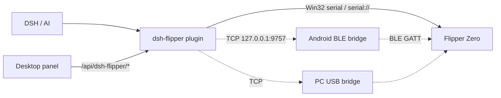

# dsh-flipper

Control a **Flipper Zero** from [DeepSeek Harness](https://github.com/deepseek-ai) with natural
language: see its screen, press buttons, launch apps, read/write the SD card, and drive
Sub-GHz / NFC / RFID / Infrared / BadUSB / GPIO.

> Unofficial project. Not affiliated with Flipper Devices Inc. Use it only on your own devices.

---

### Status: connected, but the AI has not learned the device yet

**Collecting: DeepSeek (DS) reasoning traces of driving the Flipper Zero.**
<p><b>Optimized and adapted for DSH Go on Android via plugins</b></p>
I do not have enough of the model's reasoning traces or training data, so the AI is not yet fluent
with the Flipper. I'm collecting how you and your agent actually work through it: what you asked,
how it inferred the current screen, how it navigated the menus, where it pressed the wrong thing,
how it recovered. Real traces are worth more than any amount of prompt text.

What this project does and does not do:

- **Done**: connects DSH to the Flipper (local serial / BLE bridge / TCP bridge, plus the desktop
  sidebar panel) and hands the model the *basics* — the `flipper_*` tool set, an operating section
  in the system prompt, and the bundled `dsh-flipper` skill.
- **Not done**: the model has not mastered the device. The screen is 128×64 monochrome, menus are
  icon rows and inverted blocks, and one button means different things on different pages. A tool
  manual alone does not teach that; it takes repeated trial and error on real tasks.

Share traces or just talk shop: **QQ 1132359085**

---

## What's inside

| Part | Description |
|---|---|
| **DSH plugin** (repo root, Node.js) | Registers `flipper_*` tools, injects an operating guide into the system prompt, ships a `dsh-flipper` skill, adds a **Flipper panel to the desktop Web GUI** (screen mirror, D-pad, apps, SD card, CLI, one-click connect), and a status panel to the dsh-go mobile app |
| **Android BLE bridge** (`android/`) | Bridges the Flipper's Bluetooth serial profile to `127.0.0.1:9757`, because the DSH engine runs inside proot and cannot access Android BLE APIs |

On a desktop the easiest path needs no scripts at all: the plugin drives the COM port through
Win32 directly (`CreateFileW` / `SetCommState` / `ReadFile` / `WriteFile` via koffi, which ships
with DSH Desktop), auto-detects the Flipper by USB VID/PID `0483:5740`, and the panel's Connect
button is all a user has to press. The Python bridge (`tools/flipper-bridge.py`) is still there as
a fallback for `tcp://<pc>:9757`.

## Features

- **Screen**: 128x64 monochrome; ASCII (the actual UI), braille, and PNG for `read_image`
- **Input**: up/down/left/right/ok/back, short/long; `observe=true` captures the screen after a keypress
- **Apps**: start/exit/load file/buttons; built-in Sub-GHz, NFC, 125 kHz RFID, Infrared, iButton, Bad USB, U2F, GPIO
- **Files**: list/read/write/delete/rename/md5/stat under `/ext`
- **System**: battery, time, alert, reboot, properties, desktop lock
- **Discovery**: `flipper_capabilities` returns installed FAPs, resource-file counts/examples, tools, and workflows
- **Agent loop**: system prompt + bundled skill + observe → act → observe
- **Desktop panel**: live screen mirror, D-pad, one-click app launch, SD-card browser with text preview, CLI, port picker — sharing one RPC session with the agent
- **No-Python connect on Windows**: native Win32 serial, Flipper auto-detection, optional connect-on-boot
- **dsh-go adaptation**: status strip above the composer, a "Flipper 状态" side panel (live screen, battery/firmware, D-pad), screen captures rendered as native image cards, and `link` defaulting to `ble` on the phone

## dsh-go plugin adaptation

The dsh-go mobile app is a Flutter native UI, not the web panel, so the plugin registers native
components through `ctx.dshGo` instead of React routes and `/api/dsh-flipper/*`. Both front ends
read from the same `Manager`, so the app and the agent share one RPC session.

| Where | What |
|---|---|
| "Flipper 状态" side panel | 128×64 screen mirror (5 s, PNG inlined, nothing written to disk), battery/firmware metrics, free storage, six D-pad keys that re-capture after each press, refresh/connect |
| Status strip above the composer | `Flipper 100%` / `Flipper 未连接`, refreshed every 15 s; silent when offline |
| Tool result card | `flipper_screen` renders the capture as a native image card through `presentationMeta['dsh-go/view']` |
| Link inference | on the phone `link` defaults to `ble` (`tcp://127.0.0.1:9757`); `flipper_cli` reports that BLE has no CLI channel |

<p align="center">
  
</p>
<p align="center"><i>The "Flipper 状态" panel: live screen mirror, battery/firmware, free storage, D-pad — connected over the BLE bridge at tcp://127.0.0.1:9757</i></p>

<p align="center">
  
</p>
<p align="center"><i>The Android BLE bridge: scan/pair → GATT connect → local TCP listener on 9757, with characteristic, MTU 247 and packet size in the log</i></p>

## Architecture



## Quick start

```sh
git clone <repo-url> dsh-flipper
cd dsh-flipper
./install.sh          # Linux / macOS / phone proot
# Windows: .\install.ps1
```

Or install straight from GitHub: `dsh plugin --profile desktop add github:<you>/dsh-flipper`.

Restart DSH, then connect:

- **Desktop serial (recommended)**: plug the Flipper in, close qFlipper, open the **Flipper** panel
  in the sidebar and press Connect — or `flipper_connect()` with no arguments
  (`serial://COM6` to be explicit). Nothing else to run on Windows.
- **Android BLE bridge**: install `dist/flipper-ble-bridge-1.6.apk`, turn on Flipper Bluetooth,
  pair (PIN on the Flipper), wait for `TCP 监听 127.0.0.1:9757`, then
  `flipper_connect(endpoint="tcp://127.0.0.1:9757")`.
- **PC USB bridge** (fallback): plug the Flipper into a PC, run `python3 tools/flipper-bridge.py`,
  then `flipper_connect(endpoint="tcp://<pc-ip>:9757")`.
- **PC-side DSH**: install the same plugin on the PC; it gets the same system prompt and
  `dsh-flipper` skill. `flipper_cli` works on `usb`/`serial`, not on `ble`. `link` defaults to
  `ble` on the phone, `serial` for a local port, and `usb` for a TCP bridge.

## Tools

`flipper_connect`, `flipper_disconnect`, `flipper_status`, `flipper_capabilities`,
`flipper_screen`, `flipper_input`, `flipper_app`, `flipper_storage`, `flipper_system`,
`flipper_gpio`, `flipper_cli` (USB CLI only; not available over BLE).

## Protocol

BLE service/characteristics, varint framing, and the 128x64 page-major framebuffer are
documented in [docs/PROTOCOL.md](docs/PROTOCOL.md).

## Build / test

```sh
node test/e2e.mjs          # offline mock: protocol, screen, keys, storage, CLI
node test/api-e2e.mjs      # offline mock: /api/dsh-flipper/* panel routes
cd android && ./build.sh   # or open android/ in Android Studio
```

## License

MIT. The launcher icon is supplied by the project author and is not covered by the MIT
license — see [NOTICE.md](NOTICE.md).

中文说明见 [README.md](README.md)。
