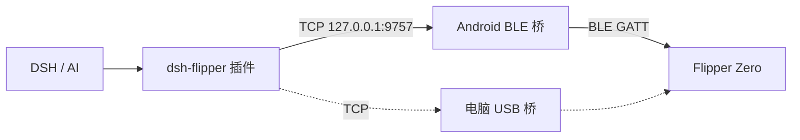

<div align="center">
  
  <h1>dsh-flipper</h1>
  <p><b>让 AI 通过 DSH 遥控 Flipper Zero</b></p>
  <p>看屏幕 · 按键 · 启动 App · 读写 SD 卡 · Sub-GHz / NFC / RFID / 红外 / BadUSB / GPIO</p>
  <p>
    
    
    
    
  </p>
</div>

<p><a href="README.en.md">English</a> · 中文</p>

> 非官方项目，与 Flipper Devices Inc. 没有隶属关系。仅用于你自己的设备。

## 这是什么

**dsh-flipper** 把 Flipper Zero 变成一个 AI 可以操作的手持设备。仓库包含两部分：

| 部分 | 说明 |
|---|---|
| **DSH 插件**（根目录，Node.js） | 注册 `flipper_*` 工具：截屏、按键、启动 App、读写 SD 卡、GPIO、系统操作；往系统提示注入操作手册；随包注册 `dsh-flipper` 技能；dsh-go 手机端有「Flipper 状态」面板 |
| **Android BLE 桥**（`android/`） | 把 Flipper 的蓝牙串口桥接到本机 `127.0.0.1:9757`。DSH 引擎跑在 proot 里拿不到 Android BLE，所以需要这个原生桥 |

不想用蓝牙也可以：电脑插 Flipper 跑 `tools/flipper-bridge.py`，插件连 `tcp://电脑IP:9757`；电脑本机还能直接 `serial:///dev/ttyACM0`。

## 特性

- **屏幕**：128x64 单色，ASCII（就是实际界面）/ 盲文点阵 / PNG（可 `read_image` 细看）
- **按键**：up / down / left / right / ok / back，短按/长按；`observe=true` 按键后自动截图
- **App**：启动、退出、加载文件、按钮、读取错误；内置 Sub-GHz、NFC、125 kHz RFID、红外、iButton、Bad USB、U2F、GPIO、Music Player
- **文件**：`/ext` 列出/读/写/删除/重命名/md5/stat
- **系统**：电量、时间、响铃、重启、property、桌面锁定/解锁
- **发现**：`flipper_capabilities` 一次返回内置 App、第三方 FAP、各资源目录的数量与示例、工具清单和工作流
- **AI 自主**：系统提示 + 随包技能 + 观察 → 行动 → 观察循环
- **dsh-go 面板**：输入框上方状态条 + 会话侧边「Flipper 状态」面板（实时屏幕、电量、方向键）

## 截图

<p align="center">
  
  
</p>
<p align="center"><i>插件抓到的真实 Flipper 屏幕（128x64，放大 4 倍）</i></p>

## 架构



- 蓝牙链路：`Flipper --BLE--> Android 桥 --TCP localhost--> DSH 插件`
- 电脑链路：`Flipper --USB--> flipper-bridge.py --TCP--> DSH 插件`
- 直连链路：`Flipper --USB--> DSH（serial://）`

详见 [docs/ARCHITECTURE.md](docs/ARCHITECTURE.md)。

## 快速开始

### 1. 安装 DSH 插件

```sh
git clone <repo-url> dsh-flipper
cd dsh-flipper
dsh plugin --profile web add "$PWD"
```

dsh-go 用户建议把整个目录放到 `$DSH_HOME/dsh-go/plugins/dsh-flipper`（引擎重置会保留），再执行 `dsh plugin add`。

装完在 App **设置 → 引擎 → 重启引擎**。插件零运行时依赖，要求 Node 20+、DSH `>= 0.2.1-rc.2 < 0.3.0`。

### 2. 连接 Flipper

#### A. Android 蓝牙桥（推荐，无线）

1. 安装 [`dist/flipper-ble-bridge-1.6.apk`](dist/flipper-ble-bridge-1.6.apk)（debug 签名，侧载）
2. Flipper：`设置 → 蓝牙 → ON`；关掉官方 Flipper App（会占用 BLE）
3. 打开桥 App，允许定位权限，点「扫描并连接 Flipper」
4. 首次配对：Flipper 屏幕显示 PIN，在系统弹窗输入
5. 日志出现 `TCP 监听 127.0.0.1:9757` 即成功

然后在 DSH 里：

```text
flipper_connect(endpoint="tcp://127.0.0.1:9757")
```

#### B. 电脑 USB 桥

电脑插 Flipper，关掉 qFlipper：

```sh
pip install pyserial
python3 tools/flipper-bridge.py
```

记下打印的 `tcp://192.168.x.x:9757`，在 DSH 里 `flipper_connect` 这个地址。Windows 可双击 `tools/start-bridge-windows.bat`。

#### C. 电脑本机串口直连

```text
flipper_connect(endpoint="serial:///dev/ttyACM0", link="serial")
```

Linux 需要把用户加入 `dialout` 组；Windows 可用 `serial://COM5`，但更推荐上面的 USB 桥。

### PC 端 DSH 也能用

PC 上安装同一个插件即可，模型会拿到**同样的系统提示和 `dsh-flipper` 技能**。区别只在连接方式和 `link` 字段：

| 场景 | 连接方式 | link | `flipper_cli` |
|---|---|---|---|
| 手机/平板 | Android BLE 桥，`tcp://127.0.0.1:9757` | `ble` | ❌ 无 CLI 通道 |
| 电脑 USB 桥 | `python3 tools/flipper-bridge.py` → `tcp://电脑IP:9757` | `usb` | ✅ |
| 电脑串口直连 | `serial:///dev/ttyACM0` / `serial://COM5` | `serial` | ✅ |

- `flipper_connect` 的 `link` 不填时按环境自动推断：手机（dsh-go 环境）= `ble`，电脑 = `usb`/`serial`。
- 电脑 USB 桥是透明串口中继，所以 CLI 也能用；BLE 桥没有 CLI 文本通道。
- PC 端安装：`dsh plugin --profile web add <repo>`（桌面端把 `web` 换成 `desktop`），然后重启引擎；`flipper_connect(endpoint="tcp://127.0.0.1:9757", link="usb")`。

## 工具

| 工具 | 作用 |
|---|---|
| `flipper_connect` | 配置并连接（`tcp://` / `serial://`） |
| `flipper_disconnect` | 断开连接 |
| `flipper_status` | 连接、固件、电量、存储、当前 App 状态 |
| `flipper_capabilities` | 设备里有什么：内置 App、第三方 FAP、资源文件、工作流 |
| `flipper_screen` | 截屏（ASCII / 盲文 / PNG） |
| `flipper_input` | 按键；`observe=true` 自动回图 |
| `flipper_app` | 启动/退出 App、`load_file`、`button`、`get_error` |
| `flipper_storage` | 列出/读/写/删除/重命名/md5/stat |
| `flipper_system` | 电量、时间、响铃、重启、property、桌面 |
| `flipper_gpio` | GPIO 输入输出、上下拉、OTG |
| `flipper_cli` | CLI（仅 USB 串口直连；BLE 下不可用） |

## AI 自主操作

插件会往系统提示注入一段 Flipper 操作说明，并随包注册 `dsh-flipper` 技能。模型的工作循环：

1. `flipper_status` 确认连接
2. `flipper_capabilities` 了解设备里的 App 和文件
3. `flipper_screen` 看当前界面
4. `flipper_input`（`observe=true`）或 `flipper_app` 行动
5. 再截图确认，不对就 BACK 调整

示例说法：

- 「看看 Flipper 现在什么界面」
- 「打开 NFC，把卡贴上去读一下」
- 「列出 /ext/subghz，然后发射 Flip1.sub」
- 「把 /ext/nfc 的文件按时间排一下」

发射 Sub-GHz/红外、模拟 NFC/RFID、运行 BadUSB、重启/恢复出厂前，模型会先征求你的同意。

## 配置

`flipper_connect` 会把连接参数写到 `~/.dsh/flipper/config.json`：

```json
{
  "transport": "tcp",
  "tcpHost": "127.0.0.1",
  "tcpPort": 9757,
  "serialPath": "",
  "baud": 230400,
  "timeoutMs": 8000,
  "link": "auto"
}
```

`link` 可以是 `auto` / `ble` / `usb` / `serial`；它决定 `flipper_status` 报告 `cliAvailable` 的真假。也支持环境变量 `FLIPPER_TCP=host:port` / `FLIPPER_SERIAL=/dev/ttyACM0`。截图默认保存到 `~/.dsh/flipper/screens/`。

## 构建

### 插件

无构建、零依赖：

```sh
node test/e2e.mjs        # 协议 + 截图 + 按键 + 存储 + CLI（离线模拟器）
node test/tool-e2e.mjs   # 走真实 defineTool 校验（需要本机 DSH）
```

### Android 桥

用 Android Studio 打开 `android/`，或：

```sh
cd android
./build.sh
# 需要 Debian/Ubuntu 的 android-sdk-platform-23、android-sdk-build-tools、apksigner
```

`targetSdk 25` 是为了避开新系统的通知渠道和 Android 12+ 蓝牙权限限制；仅适合侧载。详见 [android/README.md](android/README.md)。

## 协议

- BLE GATT 服务/特征 UUID、RPC 自动会话、varint 分帧、128x64 纵向页帧格式、USB 与 BLE 的差异：见 [docs/PROTOCOL.md](docs/PROTOCOL.md)。
- 固件侧依据：[flipperzero-firmware](https://github.com/flipperdevices/flipperzero-firmware)、[flipperzero-protobuf](https://github.com/flipperdevices/flipperzero-protobuf)。

## 兼容性

- 实测：Flipper Zero 固件 `v1.1.6`，protobuf `0.25`，Android 14 平板（PC 模式），DSH `0.2.2-rc.1`。
- 其他固件字段/帧格式可能不同；截图是噪声时先核对 `docs/PROTOCOL.md`。
- BLE 下没有 CLI 文本通道，`flipper_cli` 不可用；USB 串口直连可用。

## 安全与合规

- 仅用于你自己的设备。
- 发射射频/红外、模拟 NFC/RFID、运行 BadUSB 可能受当地法律限制，请先确认。
- 不要干扰公共频段、门禁或他人设备。
- TCP 桥没有鉴权：只监听本地或可信局域网。

## 排障

| 现象 | 处理 |
|---|---|
| `ECONNREFUSED 127.0.0.1:9757` | 桥 App 没监听：看 App 日志有没有 `TCP 监听`；确认 APK 是 1.6+（含 `INTERNET` 权限） |
| `CCCD 缺失` / 连上收不到数据 | 先在系统蓝牙取消配对、关开蓝牙，再重新配对；确认 TX/RX UUID 没写反 |
| `APP_SYSTEM_LOCKED` | 菜单/文件浏览器占着 loader，先按 BACK 回桌面 |
| 截图是噪声 | 帧格式/固件不匹配；核对 [docs/PROTOCOL.md](docs/PROTOCOL.md) 的纵向页格式 |
| BLE 断开 | App 里点「重新连接 Flipper」，再 `flipper_connect` |

## 目录结构

```text
.
├── index.js              # DSH 插件入口（工具 + 系统提示 + dsh-go 面板）
├── lib/                  # protobuf / RPC / 传输 / 屏幕 / 管理器
├── skill/                # 随包技能（完整操作手册）
├── tools/                # 电脑 USB 桥、Termux 桥
├── test/                 # 离线模拟器与端到端测试
├── android/              # Android BLE 桥源码
├── docs/                 # 协议、架构、截图
└── dist/                 # 预编译 APK
```

## License

MIT，见 [LICENSE](LICENSE)。

`android/` 的启动图标由项目作者提供，**不在 MIT 授权范围内**；如果你不是作者，请在发布前替换，见 [NOTICE.md](NOTICE.md)。

## 致谢

- [flipperzero-firmware](https://github.com/flipperdevices/flipperzero-firmware) / [flipperzero-protobuf](https://github.com/flipperdevices/flipperzero-protobuf)
- [DeepSeek Harness](https://github.com/deepseek-ai)
- pyserial
