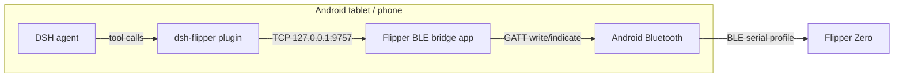
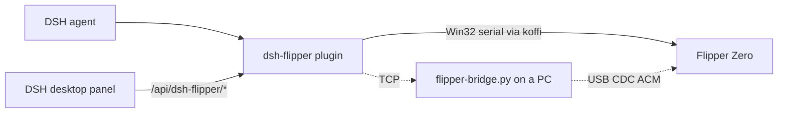
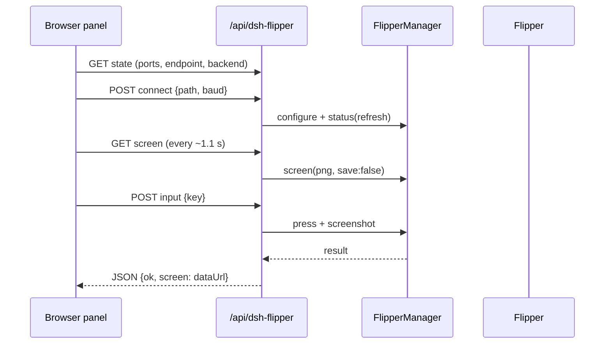
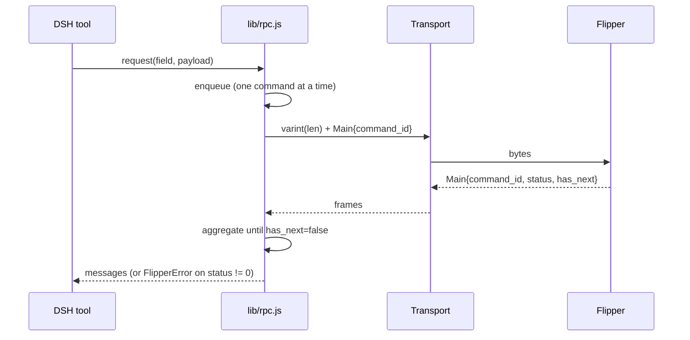

# Architecture

## BLE path

The DSH engine runs under proot and has no Android Bluetooth APIs. The bridge app is the
only process that speaks GATT; it exposes a plain localhost TCP socket so the plugin can
treat BLE like any other byte stream.

## USB path

The desktop panel and the agent share one `FlipperManager`, so both drive the same RPC session;
the panel never opens the port a second time.

## Components

| Component | Language | Responsibility |
|---|---|---|
| `index.js` | Node ESM | Tool registration, system-prompt section, skill registration, `/api/dsh-flipper/*` mount, auto-connect, dsh-go panel |
| `lib/api.js` | Node | Panel HTTP routes (state/ports/connect/status/screen/input/app/storage/cli/system/logs), loopback-only fence |
| `lib/client.js` | Browser ESM | DSH Web GUI panel: sidebar row + center page (`window.__ModuleLoader__.load` wrapper, React from the shell) |
| `lib/serial-koffi.js` | Node | Windows serial through `kernel32` (CreateFileW/SetCommState/ReadFile/WriteFile) via koffi |
| `lib/ports.js` | Node | Port enumeration; Windows CIM lookups identify the Flipper by `VID_0483&PID_5740` (15 s cache) |
| `lib/rpc.js` | Node | Varint framing, command queue, screen stream, CLI mode switch |
| `lib/messages.js` | Node | Protobuf field numbers, request builders, response decoders |
| `lib/transport.js` | Node | TCP transport, serial factory (Win32 → fs/stty fallback), port discovery |
| `lib/screen.js` | Node | Page-major framebuffer → PNG / ASCII / braille |
| `lib/manager.js` | Node | Connection lifecycle, status, capabilities, high-level operations |
| `android/` | Java | GATT client, pairing, TCP bridge, foreground service |
| `tools/flipper-bridge.py` | Python | PC USB serial ↔ TCP relay (fallback) |
| `tools/flipper-termux-bridge.py` | Python | Experimental Termux USB OTG ↔ TCP relay |

## Windows serial internals

1. `CreateFileW('\\\\.\\COM6', GENERIC_READ|GENERIC_WRITE, 0, …, OPEN_EXISTING, 0, 0)`.
2. `SetCommState` with a 28-byte DCB: `Ba=baud`, `8N1`, `fBinary|DTR_CONTROL_ENABLE|RTS_CONTROL_ENABLE`
   (`0x1011`) — the Flipper only streams once DTR is asserted.
3. `SetCommTimeouts` with `ReadIntervalTimeout = MAXDWORD` and both totals `0`, which makes
   `ReadFile` return immediately with whatever is buffered instead of parking a thread.
4. A `setTimeout` pump reads every 4 ms (0 ms when data was present) and emits `data`.
   `PurgeComm` on open, `CloseHandle` on close — no blocking read that cannot be cancelled.
5. When koffi is missing, the plugin falls back to `fs` + `mode`/`stty`, then to the Python bridge.

## Panel request flow

Every handler answers HTTP 200 with `{ok:false, error}` on failure so the panel can show the
message instead of throwing.

## RPC request lifecycle

## Screen capture

1. `gui_start_screen_stream` (field 20) → OK.
2. The first frame can arrive in the same TCP chunk as the OK; the client stores
   `lastFrame` and uses it if it was produced after the start request.
3. `gui_stop_screen_stream` (field 21) runs in a `finally` block.
4. `lib/screen.js` decodes page-major 1bpp and renders ASCII / PNG.

## Android bridge threading

- `BridgeService`: foreground service, owns the GATT connection + TCP server.
- `FlipperBle`: GATT callback; queues writes and waits for `onCharacteristicWrite` so only
  one ATT write is in flight; reassembles indications into a byte stream.
- `TcpServer`: one client at a time, read thread → BLE; BLE callback → socket. It swallows
  the plugin's `start_rpc_session\r` and echoes a newline.
- `MainActivity`: permissions, BLE scan (service-UUID detection + device picker), pairing,
  log.

## Trust boundaries

- The TCP bridge binds `127.0.0.1` only; no LAN exposure.
- `/api/dsh-flipper/*` rejects any request whose socket is not loopback (`403`), because the
  panel can press buttons, write SD-card files and run CLI commands.
- The BLE link requires bonding (PIN shown on the Flipper).
- The plugin has full control of the Flipper; destructive actions are gated by the agent's
  system prompt and explicit user confirmation, not by the transport.
- `flipper_cli` is USB-only; BLE has no CLI channel. The panel's CLI box refuses
  `factory_reset`, which is only reachable through `flipper_system` with its explicit
  `confirm: "FACTORY RESET"` argument.
