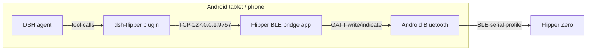
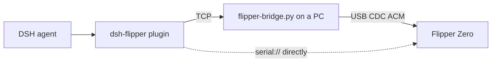
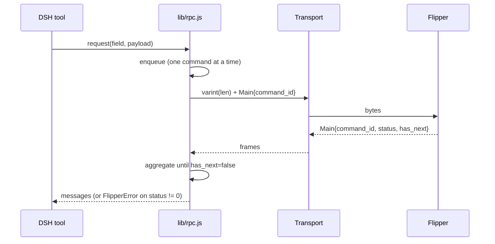

# Architecture

## BLE path

The DSH engine runs under proot and has no Android Bluetooth APIs. The bridge app is the
only process that speaks GATT; it exposes a plain localhost TCP socket so the plugin can
treat BLE like any other byte stream.

## USB path

## Components

| Component | Language | Responsibility |
|---|---|---|
| `index.js` | Node ESM | Tool registration, system-prompt section, skill registration, dsh-go panel |
| `lib/rpc.js` | Node | Varint framing, command queue, screen stream, CLI mode switch |
| `lib/messages.js` | Node | Protobuf field numbers, request builders, response decoders |
| `lib/transport.js` | Node | TCP and serial transports, port discovery |
| `lib/screen.js` | Node | Page-major framebuffer → PNG / ASCII / braille |
| `lib/manager.js` | Node | Connection lifecycle, status, capabilities, high-level operations |
| `android/` | Java | GATT client, pairing, TCP bridge, foreground service |
| `tools/flipper-bridge.py` | Python | PC USB serial ↔ TCP relay |
| `tools/flipper-termux-bridge.py` | Python | Experimental Termux USB OTG ↔ TCP relay |

## RPC request lifecycle

## Screen capture

1. `gui_start_screen_stream` (field 20) → OK.
2. The first frame can arrive in the same TCP chunk as the OK; the client stores
   `lastFrame` and uses it if it was produced after the start request.
3. `gui_stop_screen_stream` (field 21) runs in a `finally` block.
4. `lib/screen.js` decodes page-major 1bpp and renders ASCII / PNG.

## Android bridge threading

- `BridgeService`: foreground service, owns the GATT connection + TCP server.
- `FlipperBle`: GATT callback; queues writes and waits for `onCharacteristicWrite` so only
  one ATT write is in flight; reassembles indications into a byte stream.
- `TcpServer`: one client at a time, read thread → BLE; BLE callback → socket. It swallows
  the plugin's `start_rpc_session\r` and echoes a newline.
- `MainActivity`: permissions, BLE scan (service-UUID detection + device picker), pairing,
  log.

## Trust boundaries

- The TCP bridge binds `127.0.0.1` only; no LAN exposure.
- The BLE link requires bonding (PIN shown on the Flipper).
- The plugin has full control of the Flipper; destructive actions are gated by the agent's
  system prompt and explicit user confirmation, not by the transport.
- `flipper_cli` is USB-only; BLE has no CLI channel.
